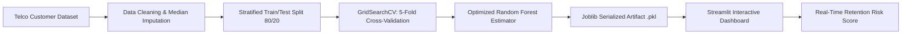

# Telco Customer Churn Intelligence & Diagnostic System 🛡️

[](https://www.python.org/)
[](https://scikit-learn.org/)
[]()
[](https://streamlit.io/)
[](https://opensource.org/licenses/MIT)

> **End-to-end customer churn classification pipeline incorporating robust feature preprocessing, 5-fold cross-validated hyperparameter optimization (GridSearchCV), and an interactive Streamlit inference dashboard.**

---

## 🚀 Overview

Customer churn represents significant revenue attrition for subscription-based telecommunication providers. This repository implements a self-bootstrapping MLOps classification system that ingests customer tenure, monthly charges, and lifetime billing records to predict churn probabilities and prescribe retention intervention.

### Core Highlights:
- **Robust Preprocessing Pipeline:** Automated handling of non-numeric whitespace artifacts and median imputation on continuous variables (`TotalCharges`).
- **Ensemble Bagging Architecture:** Multi-tree Random Forest Classifier designed to reduce variance and mitigate overfitting on imbalanced boundary distributions.
- **5-Fold Cross-Validation:** Hyperparameter grid optimization tuning tree depth, estimator counts, and internal split thresholds.
- **Interactive Streamlit Web Dashboard:** Real-time customer scenario evaluation with probabilistic risk scoring.

---

## 🏗️ Pipeline Architecture



---

## 🧠 Model Specifications & Hyperparameter Tuning

```yaml
Base Estimator:         RandomForestClassifier(random_state=42)
Validation Strategy:    5-Fold Stratified Cross-Validation
Hyperparameter Space:
  n_estimators:         [50, 100, 150]
  max_depth:            [5, 10, 15]
  min_samples_split:    [2, 5, 10]
Evaluation Metric:      Cross-Validated Accuracy & ROC-AUC
Artifact Export:        churn_model.pkl
```

---

## 🛠️ Tech Stack

- **Language:** Python 3.9+
- **Machine Learning:** `scikit-learn`, `joblib`
- **Data Engineering:** `pandas`, `numpy`
- **Application Dashboard:** `streamlit`

---

## 🚀 Quickstart & Local Setup

### 1. Clone the repository
```bash
git clone https://github.com/Jyotiraditya1006/Customer-Churn-Detection-System.git
cd Customer-Churn-Detection-System
```

### 2. Set up virtual environment & dependencies
```bash
python -m venv venv
# Windows:
.\venv\Scripts\activate
# Linux/macOS:
source venv/bin/activate

pip install -r requirement.txt
```

### 3. Train the model (Grid Search)
```bash
python train_model.py
```

### 4. Launch the Streamlit dashboard
```bash
streamlit run app.py
```
Open **[http://localhost:8501](http://localhost:8501)** to evaluate churn risk interactively.

---

## 📜 License
Distributed under the MIT License. See [LICENSE](LICENSE) for details.
